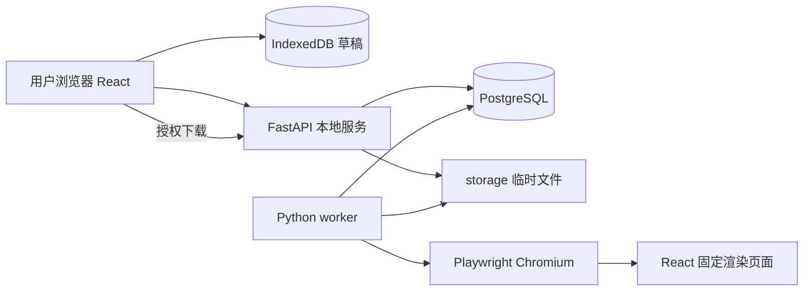

# CreatorHub 技术实现设计

版本：0.1 · 日期：2026-09-23 · 状态：设计基线；首版已落地，差异及验证见 `08-首版实现与验证记录.md`

## 1. 技术决策

| 层 | 选择 | 原因与边界 |
| --- | --- | --- |
| 前端 | React + TypeScript + Vite | 工具型 SPA，组件复用，构建后静态服务；不引入 Next.js 服务端 |
| 路由 | React Router | 工具独立路由、帮助与设置页 |
| API | Python 3.11 + FastAPI + Pydantic 2 | 类型化参数校验、OpenAPI；先使用同步数据库访问 |
| 数据访问 | SQLAlchemy 2 + psycopg 3 + Alembic | PostgreSQL 读写、事务、可追溯迁移 |
| 数据库 | 本地 PostgreSQL 16 | 复用已安装服务；持久化目录、匿名资源、渲染任务及租约 |
| 渲染 | Python Playwright + 配套 Chromium | 真实浏览器排版与元素截图；锁定版本 |
| 任务执行 | 独立 Python worker + PostgreSQL 任务表 | API 重启不丢任务；首版无 Redis、Celery 或 Docker |
| 临时文件 | 项目 `storage/` | 原始 Logo、页面文件和 ZIP；不把二进制放入 JSONB |
| 本机草稿 | IndexedDB | 无登录、保留 Logo Blob、大文本与配置 |
| 测试 | pytest、Vitest、Playwright | 规则、API 与关键用户流程验证 |

具体依赖补丁版本在开发启动时验证兼容性并锁定，不把“latest”用于可复现安装。Node.js 仅用于前端工具链，不承载业务后端。禁止引入 Docker 或用 SQLite 替代验收数据库。

## 2. 运行架构



开发运行四个本机进程/服务：PostgreSQL、FastAPI、Vite、Python worker。运行构建版时由 FastAPI 提供前端静态产物，省去 Vite 常驻；渲染 worker 使用固定构建的渲染入口，不加载 HMR 模块。

所有开发服务默认绑定 `127.0.0.1`。公开部署不是本次阶段任务；将来开放到网络时另行处理 HTTPS、反向代理、机器资源限额与真实容量评估。

## 3. 拟定目录结构

```text
CreatorHub/
  项目说明.md
  docs/
  backend/
    pyproject.toml
    requirements.lock.txt
    .env.example
    app/
      main.py
      core/                 # 配置、日志、数据库、匿名会话
      api/                  # tools / templates / assets / renders
      models/
      schemas/
      services/             # 资产、快照、任务、授权下载
      worker.py
      rendering/            # Python Playwright 驱动与输出校验
    migrations/
    tests/
  frontend/
    package.json
    package-lock.json
    src/
      app/
      features/tool-catalog/
      features/article-to-images/
      features/local-drafts/
      rendering/            # 共享模板、测量、分行分页、导出入口
      shared/
    public/fonts/           # 字体与许可证
    tests/
  scripts/                  # PowerShell 启停、环境检查、迁移辅助
  storage/                  # 忽略提交；运行时创建
```

前端只保留一套模板组件与分页实现。Python 负责调度浏览器、管理文件和 API，不再实现第二套中文排版算法。

## 4. 文本处理与分页

### 4.1 统一输入

1. 用户输入保留 sourceText；按显式操作解析为结构化内容块。
2. 只把 CRLF 统一为 LF，并记录其他格式转换；不得对正文全局 trim 或合并空格导致内容丢失。
3. 对支持的 Markdown 语法解析为受限内容块；不使用任意 HTML。
4. 每块分配稳定 blockId，行内片段记录普通/加粗标记。分页引用 blockId 和字符范围，不复制修改原文。
5. 用户编辑后提升 revision；手工分页作为独立 `page_break` 块保留。

产品长度上限按 Unicode 码点计数。JS `string.length` 是 UTF-16 单元数，不能直接用于产品上限；后端与前端测试必须一致。内部分页范围定义为块可见文本的 UTF-16 半开区间，切分点必须处于合法字素簇边界，便于 DOM Range 测量。

### 4.2 准备排版环境

- 画布固定像素宽高，预览仅使用外部缩放；测量元素不得被 CSS transform 影响。
- 明确字号、字重、line-height、box-sizing 和所有 margin，禁止依赖浏览器默认样式。
- 等待 `document.fonts.ready`，再显式检查使用的 FontFace 已加载及 `document.fonts.check`；字体失败是错误，不无限等待。
- 等待图片 decode，并固定图片宽高；校验加载失败。
- 字体、Logo 和模板全部就绪后才进行测量。预览与输出使用同版本字体和样式。

### 4.3 标题分行

提供确定性候选断点：用户换行、标点、空格和可用中文分词结果。对候选行组合测量宽度，按溢出惩罚、孤字惩罚、行宽差、短语中断惩罚评分；选取最小代价组合。分词仅为启发式，最终保留人工换行入口。

手动换行无法解决的超长行可继续安全折行并给出提示。仅在启用标题自动适配时调整字号，低于设置范围仍不能容纳则返回 `TITLE_OVERFLOW`。

### 4.4 正文分页

基本流程：

```text
计算正文矩形 = 画布 - 页边距 - 品牌区 - 页脚 - 首图标题区
按顺序读取内容块
  显式分页：有内容则结束当前页，空页则折叠标记
  块可放入：放入，并测量小标题与跟随正文约束
  块不能放入但可独占新页：优先整体移动
  块高于整页：查找合法行边界，选择当前页能容纳的最大前缀
    回退到附近句末，满足孤行要求时采用
    记录 sourceRange 后进入下一页，处理剩余文本
  无合法进展：明确报错，避免无限循环
最终：检查范围覆盖、边界、总页数与空白页
```

用 DOM Range 的行矩形识别真实折行，必要时二分查找可容纳前缀；不要逐字反复全量布局。使用 `Intl.Segmenter` 或等效字素簇分段保证组合 Emoji、代理对不被拆坏。

对超长英文串/URL 允许 `overflow-wrap:anywhere` 作为最后降级；中文使用适当 line-break 规则并辅以检查。列表长项可以跨页，但续页不重复前缀编号。连续短段落过多时维持最小段距，不通过删空段以外的内容填满页面。

分页输出含每页片段、sourceRange、诊断警告、layoutVersion。跨页片段范围必须恰好覆盖每个可见内容块，互不重叠；页码和品牌为装饰，不参与正文完整性比对。

### 4.5 预览一致性

浏览器即时预览是近似布局，服务端高清预览是权威结果。生成动作保存不可变 snapshot，包含模板/字体/排版版本、revision、格式和画布设置。

worker 使用同一 React 渲染包生成图片后，浏览器直接显示这些图片。下载从同一任务产物取得，不再二次排版。因此“高清预览与下载一致”可通过文件哈希检验，避免承诺不同操作系统浏览器的草图像素完全相同。

## 5. Python 图片渲染

1. worker 领取任务，验证快照、模板、资产、容量限制。
2. 打开固定本机渲染入口，使用固定 viewport、deviceScaleFactor=1、固定 locale/timezone、无动画样式。
3. 服务端验证并读取该任务合法资产，把 Logo 作为受控 data URL 传入页面；不让页面访问任意磁盘路径。
4. 通过 Playwright 的结构化参数传入数据，由 React 安全渲染文本；不得拼接正文到可执行 JavaScript 或未经转义的 HTML。
5. 浏览器只能请求固定渲染源及必要同源字体；阻断其他网络导航和外部资源请求。
6. 等待显式 ready/failed 协议，取得分页清单和诊断；完成内容覆盖与边界校验。
7. 对每个固定尺寸页元素截图 PNG 或 JPEG；解码验证实际像素、数量、文件非空。
8. 图片写入任务 attempt 临时目录；生成 manifest 与 ZIP；校验完整后原子移动/发布，最后提交成功状态。

生成中不得暴露半份成品。JPEG 质量初始 95，背景固定白色；PNG 默认。每页最多 1080×1920，按页生成以限制内存峰值。Pillow 用于上传图片解码、方向修正、元数据清理和成品像素校验，不负责绘制文字。

## 6. 队列、重试与取消

- `render_jobs` 存任务状态，worker 用短事务 `SELECT ... FOR UPDATE SKIP LOCKED` 领取到期 queued 任务，领取后立即释放锁。
- 初始每个 worker 同时处理 1 个任务。单匿名会话最多 2 个非终态任务，全局非终态上限 20，创建速率初始 5 次/分钟/会话；本地版本也执行容量保护。
- running 任务记录 lease_token、worker_id、lease_expires_at，每 10 秒续租，租约 60 秒。所有续租、状态提交都条件匹配 lease_token。
- worker 主调度循环与 Playwright 子任务独立，截图阻塞期间仍可续租；进程崩溃后租约失效。
- 总执行超时初始 180 秒；从领取开始计算，不含排队。达到超时中断浏览器上下文，回收临时目录。
- 临时浏览器故障最多自动重试 1 次（总 attempts ≤2）；输入错误、字体缺失、容量错误不自动重试。
- 取消 queued 任务立即置 cancelled；取消 running 任务置 cancel_requested，由 worker 终止并确认 cancelled。
- 回收器处理过期租约：若请求取消则 cancelled；否则视重试次数重新排队或失败。旧 worker 的迟到结果因租约失效不能发布。
- 输出目录含 jobId/attempt，避免多个尝试互相覆盖；提交成品与状态失败时由清理器回收孤立目录。
- 相同会话的同一 Idempotency-Key + 请求哈希重放返回同一 job；相同 key 对应不同载荷返回 409。

## 7. 数据与资源生命周期

| 数据 | 位置 | 生命周期 |
| --- | --- | --- |
| 草稿及品牌原始图片 | IndexedDB | 用户删除或浏览器清理；最多 20 草稿 |
| 收藏/最近使用 | localStorage | 用户清理 |
| 工具及模板元数据 | PostgreSQL | 长期版本管理，无文章正文 |
| 匿名会话 | PostgreSQL + HttpOnly Cookie | 空闲 30 天过期，使用时续期；不是跨设备身份 |
| 未引用上传资产 | storage + DB | 默认上传后 24 小时 |
| 输入快照/图片/ZIP | DB + storage | 成功/失败/取消进入终态后保留 24 小时 |
| 任务最小审计元数据 | DB | 7 天，去除正文、品牌与可识别文件名 |

活动任务引用资产期间不清理；任务终态后资产保留时间至少覆盖其结果有效期。每 10 分钟清理一次，接口在过期瞬间即拒绝下载，不依赖清理进程是否刚执行。草稿保留 Logo Blob，资产过期可重新上传。

队列等待超过 30 分钟无可用 worker 时将任务置 failed，提示服务暂不可用。匿名会话过期或 Cookie 丢失后不能访问原服务端资源，但本机备份和草稿可重新生成。

## 8. 数据隔离与输入边界

- 无登录不等于资源公开。首次需要服务器资源时创建高熵随机匿名 token，Cookie `HttpOnly; SameSite=Lax; Path=/`；公开 HTTPS 时加 Secure。
- 数据库只存 token 的 SHA-256 摘要；每次读取资产、任务或下载都校验归属，URL UUID 不是访问授权。
- 开发前端使用 Vite 同源 `/api` 代理；状态变更校验 Origin/Host 白名单，不开启任意来源带凭证 CORS。
- 文件名只用于展示；磁盘路径由服务端 UUID 生成；禁止用户控制相对路径、下载成员路径或读取地址。
- 校验上传扩展名、实际解码格式、字节大小和像素数；清除 EXIF；拒绝 SVG、脚本、外部 URL 抓取。
- React 以文本节点渲染用户输入；不允许任意 HTML、CSS、JS 模板。导入项目文件必须重走 schema 校验。
- 日志不记录正文、Logo、Cookie、数据库密码。错误对外输出稳定错误码和 requestId，详细栈留在本机日志。

## 9. 可观测性与故障恢复

日志包含 requestId/jobId、阶段、耗时、页数、模板版本、错误码、重试次数。健康检查区分 API 存活与数据库可用，worker 心跳单独显示；浏览器没有安装时启动检查给出修复命令。

验证目录可写、磁盘剩余空间、字体可用。磁盘不足返回明确失败，不把半文件标记成功。数据库不可用时 API 返回 503，不降级创建内存中的假任务。

## 10. 官方资料与适用范围

- [FastAPI 文档](https://fastapi.tiangolo.com/)：Python API 框架及参数校验入口。
- [Vite 入门](https://vite.dev/guide/)：前端构建工具的环境要求，安装时再次核验。
- [Playwright Python 截图](https://playwright.dev/python/docs/screenshots)：Python 驱动浏览器及元素截图。
- [PostgreSQL JSON 类型](https://www.postgresql.org/docs/current/datatype-json.html)：结构化快照使用 JSONB；实际实现兼容本机 PostgreSQL 16。
- [FontFaceSet.ready](https://developer.mozilla.org/en-US/docs/Web/API/FontFaceSet/ready)：字体和布局等待机制。
- [小红书分享 SDK](https://agora.xiaohongshu.com/doc/ios)：包含特定分享路径的裁剪说明，不作为手动上传的完整规则。

资料核查日期 2026-09-23。本文大部分容量、保留时间、分页策略和目录结构是 CreatorHub 自身设计决定，不是上述工具或平台的官方要求。
